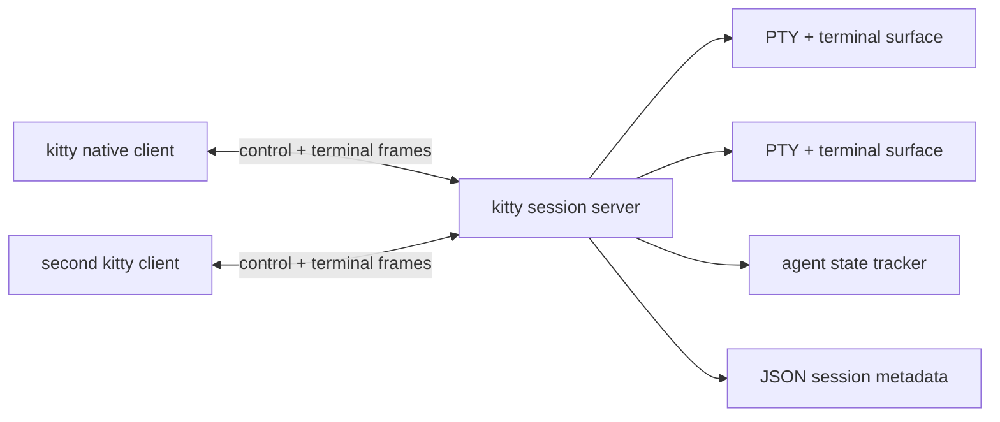

# Herdr-like agent workspace for kitty

## Conclusion

Do not port Herdr's `ratatui` client into kitty. Kitty already owns the native terminal emulator, PTY lifecycle, layouts, input dispatch, mouse handling, and OpenGL rendering. The in-process implementation uses a dedicated macOS Cocoa surface for the Agents sidebar and keeps workspace/agent metadata around existing kitty `Tab`/`Window` objects.

This gives:

- real kitty terminal windows and the existing C terminal parser;
- native kitty keyboard, mouse, clipboard, hyperlink, graphics, and layout behavior;
- agent awareness, state rollups, workspace navigation, and remote control;
- session persistence and agent resume after a kitty restart, where the agent supports a resume command.

It does **not** initially give Herdr's strongest guarantee: live PTYs surviving kitty client exit. That guarantee requires a separate server/client split and a substantial extraction of kitty's terminal core. It should be a later project, not hidden inside the first feature.

## What Herdr actually provides

Herdr is a background server plus terminal clients. The server owns panes, PTYs, terminal state, layouts, agent state, and persistence; clients attach, render, send input, and detach. The official concepts page states that panes are real terminals, the server owns process state, and detaching leaves panes running: <https://herdr.dev/docs/concepts/>.

Observed implementation structure in `herdrdev/herdr`:

| Concern | Primary source | Observed design |
|---|---|---|
| Server/client split | [`src/client/mod.rs`](https://github.com/herdrdev/herdr/blob/master/src/client/mod.rs), [`src/server/mod.rs`](https://github.com/herdrdev/herdr/blob/master/src/server/mod.rs) | Thin clients connect over a local socket. The server owns the session and streams rendered frames. |
| PTY ownership | [`src/pane.rs`](https://github.com/herdrdev/herdr/blob/master/src/pane.rs), [`src/pty/`](https://github.com/herdrdev/herdr/tree/master/src/pty) | Each pane owns a server-side PTY runtime and a terminal emulator. Pane output is parsed independently of the outer terminal. |
| Terminal state | [`src/terminal/runtime.rs`](https://github.com/herdrdev/herdr/blob/master/src/terminal/runtime.rs), [`src/terminal/state.rs`](https://github.com/herdrdev/herdr/blob/master/src/terminal/state.rs) | Terminal runtime, identity, cwd, title, agent state, metadata, and restore state are separate concepts. |
| Layout | [`src/layout.rs`](https://github.com/herdrdev/herdr/blob/master/src/layout.rs), [`src/workspace.rs`](https://github.com/herdrdev/herdr/blob/master/src/workspace.rs) | Workspaces contain tabs; tabs contain panes; panes are arranged by a serializable BSP tree. |
| Agent detection | [`src/detect/mod.rs`](https://github.com/herdrdev/herdr/blob/master/src/detect/mod.rs), [`src/pane.rs`](https://github.com/herdrdev/herdr/blob/master/src/pane.rs) | Process identity plus live bottom-of-buffer screen matching. |
| Agent integrations | [`src/integration/mod.rs`](https://github.com/herdrdev/herdr/blob/master/src/integration/mod.rs), [`src/terminal/state.rs`](https://github.com/herdrdev/herdr/blob/master/src/terminal/state.rs) | Hooks/plugins report semantic state and session references. Hook authority can override screen fallback. |
| Persistence | [`src/persist/snapshot.rs`](https://github.com/herdrdev/herdr/blob/master/src/persist/snapshot.rs), [`src/persist/writer.rs`](https://github.com/herdrdev/herdr/blob/master/src/persist/writer.rs) | JSON snapshots save workspaces, tabs, pane cwd, layout, agent identity, and optional resume references. Screen history is separate. |
| Live handoff | [`src/server/handoff.rs`](https://github.com/herdrdev/herdr/blob/master/src/server/handoff.rs), official [session-state docs](https://herdr.dev/docs/session-state/) | Optional Unix handoff transfers live PTYs between server processes. This is not equivalent to ordinary snapshot restore. |
| Automation | Official [socket API docs](https://herdr.dev/docs/socket-api/) | CLI and socket API expose workspace/tab/pane/agent operations, event subscriptions, reads, input, waits, and layout changes. |
| Client rendering | [`src/server/render_stream.rs`](https://github.com/herdrdev/herdr/blob/master/src/server/render_stream.rs), [`src/client/frame_output.rs`](https://github.com/herdrdev/herdr/blob/master/src/client/frame_output.rs) | Server emits semantic surfaces or terminal ANSI frames; the client writes ANSI/graphics to the outer terminal. |

Herdr's agent state is deliberately multi-source. The official agent documentation says supported agents are identified from foreground processes and screen manifests, while integrations can report authoritative state: <https://herdr.dev/docs/agents/>. State rolls up from pane to tab to workspace.

## Kitty seams relevant to this feature

Kitty already has most of the local primitives needed for the in-process phase:

| Kitty seam | Evidence in this checkout | Reuse |
|---|---|---|
| PTY and terminal parser | `kitty/child.py`, `kitty/child-monitor.c`, `kitty/window.py` | Keep `ChildMonitor`, `Window.child`, and the C `Screen`; do not introduce a second terminal emulator. |
| Native window hierarchy | `kitty/boss.py`, `kitty/tabs.py`, `kitty/window.py` | A workspace can group existing tabs/windows without replacing their ownership model. |
| Layout and native sidebar geometry | `kitty/state.c`, `kitty/state.h`, `kitty/cocoa_window.m`, `kitty/glfw.c` | A per-OS-window native sidebar reserves its own left region and overlays a Cocoa view; the existing tab-bar renderer is bypassed. |
| Native chrome rendering | `kitty/cocoa_window.m` | Cocoa draws the sidebar rows, active selection, and click target directly above the kitty content view. |
| Input and mouse dispatch | `kitty/cocoa_window.m`, `kitty/glfw.c`, `kitty/child-monitor.c` | Native Cocoa clicks become pending kitty actions and are resolved by `Boss`; the terminal content view keeps normal pane input. |
| Events | `kitty/window.py` watcher hooks | Existing events include resize, focus, title, user variables, command start/stop, program-status changes, tab-bar dirtiness, and close. |
| Agent/status signals | `kitty/child.py`, `kitty/window.py`, `kitty/program_status.py` | Foreground process lists, shell command lifecycle, and OSC 7501 program records are already available. |
| Control plane | `kitty/rc/base.py`, `kitty/rc/ls.py`, `kitty/remote_control.py` | Add `workspace-*` remote commands using the existing command discovery and matching rules. |
| Session persistence | `kitty/session.py`, `kitty/boss.py`, `docs/sessions.rst` | Extend session serialization with stable workspace IDs, labels, membership, and optional agent resume metadata. |
| Extension fallback | `kitty/launch.py`, `docs/launch.rst`, `kitty/kittens/` | Watchers and kittens are useful for prototyping and integrations, but should not become the core state store. |

Important current limitation: kitty's `Boss` and `ChildMonitor` are tied to the running kitty application. `kitty/main.py` initializes GLFW, creates an OS window, creates `Boss`, starts the child monitor, and runs the monitor loop. Kitty session restore restores layout and scrollback, but the session documentation explicitly says arbitrary non-shell programs are not restarted after logout/restart: `docs/sessions.rst:266-291`.

Kitty remote control is a command socket, not a terminal-server attach protocol. The docs describe `ls`, `send-text`, `launch`, focus, and other commands, but not detached PTY ownership or frame streaming: `docs/remote-control.rst:1-121`.

## Recommended in-process architecture

### 1. `WorkspaceRegistry`: metadata over existing kitty objects

Add a deep module, tentatively `kitty/workspaces.py`, owned by `Boss`:

```python
WorkspaceId = str

@dataclass
class Workspace:
    id: WorkspaceId
    label: str
    created_at: int
    tab_ids: set[int]
    active_tab_id: int | None
    cwd: str
    state: AgentState
    has_unseen_completion: bool
```

The registry owns only workspace metadata and membership. Existing `Tab`, `Window`, `WindowList`, and layout objects remain the source of truth for actual terminal geometry and PTY ownership.

Recommended invariants:

- a tab belongs to at most one workspace;
- a workspace has at least one tab while live;
- window IDs remain kitty IDs; workspace IDs are stable serialized IDs;
- closing the last tab removes the workspace after the normal kitty close flow completes;
- membership changes mark the tab bar/sidebar dirty and trigger persistence;
- workspace state is derived, not independently mutated by UI code.

Do not use `created_in_session_name` as the stable identity. It is a session label and has fallback behavior; a workspace needs an explicit versioned ID.

### 2. `AgentStateTracker`: one precedence model

Add a per-window tracker with explicit evidence sources:

1. **Integration/semantic report**: future watcher or agent hook reports `idle`, `working`, `blocked`, `done`, optional session reference and label.
2. **OSC 7501**: reuse `Window.program_status`, especially `blocked`, `working`, `done`, and `error` records.
3. **Foreground process**: inspect `Window.child.foreground_processes` and match a configurable agent executable registry.
4. **Shell lifecycle**: use `on_cmd_startstop` and prompt transitions as fallback.
5. **Screen matching**: optional manifest rules over a bounded live screen tail, never the user-selected scrollback view.

Precedence should be explicit:

```text
semantic integration authority
  > visible blocked/approval evidence
  > program status
  > process identity + screen manifest
  > shell lifecycle
  > unknown
```

Avoid treating any prompt-like text in scrollback as `blocked`. Herdr's docs call out this safety risk. A false `blocked` state is noisy; a false `idle` state can cause automation to send input into an approval prompt.

The tracker should expose a small interface:

```python
class AgentStateTracker:
    def observe_window(self, window: Window, now: float) -> StateChange | None: ...
    def report_semantic_state(self, window_id: int, report: AgentReport) -> StateChange | None: ...
    def clear_window(self, window_id: int) -> None: ...
    def state_for(self, window_id: int) -> AgentSnapshot: ...
```

The implementation can poll foreground processes on a low-frequency timer and react immediately to existing watcher/program-status callbacks. Do not run expensive screen regexes on every render frame.

### 3. Native macOS Agents sidebar

The Agents sidebar is a dedicated Cocoa `NSView`, not an extension of
`kitty/tab_bar.py`:

- `state.c` reserves a left-side region when the sidebar is enabled;
- `kitty/cocoa_window.m` owns the native view and uses macOS semantic colors;
- `kitty/glfw.c` bridges rows and native mouse clicks to the Python `Boss`;
- `child-monitor.c` skips the existing tab-bar renderer while the sidebar is active;
- the Python side only supplies row labels, active state, and target window IDs.

The sidebar provides agent rows with state icons, labels, active highlighting,
truncation, and click-to-focus behavior. Normal terminal input remains owned by
kitty's existing content view.

The current implementation is macOS-only by design. Other platforms keep the
existing tab-bar behavior and agent monitoring model.

Initial interaction model:

- `kitty_mod+a`: toggle the Agents sidebar;
- click: focus the selected agent window;
- normal pane input is unaffected;
- closing or changing the kitty window removes the native view with the OS window.

### 4. `WorkspaceController`: actions and remote control

Centralize all mutations in one controller. Keyboard actions, mouse callbacks, kittens, and remote-control commands call the same methods.

Suggested commands:

```text
workspace-list
workspace-create
workspace-focus
workspace-rename
workspace-close
workspace-move
workspace-snapshot
agent-list
agent-focus
agent-send-text
agent-report-state
agent-wait
```

Use the existing remote-control authentication and matching model. Do not expose raw internal `Boss`/`Window` objects to new clients.

`workspace-snapshot` should return stable IDs, labels, active tab/window IDs, cwd, aggregate state, and per-window agent snapshots. It should not return unbounded screen text by default.

### 5. Persistence and restore

Extend kitty session serialization with a versioned metadata block, for example:

```json
{
  "kitty_session_version": 2,
  "workspaces": [
    {
      "id": "w_01J...",
      "label": "kitty",
      "tab_ids": [12, 13],
      "active_tab_id": 12
    }
  ],
  "agent_resume": {
    "window_id": {
      "agent": "claude",
      "resume_argv": ["claude", "--resume", "..."],
      "source": "kitty-integration"
    }
  }
}
```

Restore order:

1. restore kitty tabs/windows/layouts and cwd using the existing session path;
2. reconstruct workspace membership from serialized stable IDs;
3. start a resume command only when a trusted integration supplied a valid resume specification;
4. otherwise start the normal shell in the saved cwd;
5. replay scrollback only for panes for which the existing kitty restore path is valid;
6. recompute agent state after the process has produced its first screen.

Do not claim live persistence for this phase. The documented behavior remains snapshot restore plus optional agent resume.

### 6. Agent integrations

Prefer a generic reporting protocol over hard-coded per-agent screen parsers. Kitty already has OSC parsing and `ProgramStatus`; add a kitty-specific semantic report only if the existing protocol cannot carry the required session reference.

A practical first contract is an OSC extension carrying:

```text
agent=<safe-name>
state=idle|working|blocked|done|error
session=<opaque-reference>
label=<display-label>
msg=<short-display-message>
```

Constraints:

- strict size and character limits;
- malformed reports are discarded;
- reports are scoped to the sending window;
- semantic reports expire or clear on process exit;
- resume references are never executed unless the agent is in an allowlisted integration registry;
- screen/process fallback remains available for unsupported agents.

Kitty's existing OSC 7501 implementation is a good validation and lifecycle model: `kitty/program_status.py` limits record sizes, validates IDs and text, handles process-exit/prompt transitions, and exposes watcher callbacks.

## Full detach/reattach architecture, if required later

If the requirement is specifically “close kitty, reopen later, and the original agent processes keep running,” the in-process design is insufficient. The necessary architecture is:



Required extraction:

1. split terminal surface/parser state from `Window` geometry and OS-window ownership;
2. make `ChildMonitor` usable without GLFW/OS-window creation;
3. give the server a headless terminal surface and PTY resize/input API;
4. define a versioned attach protocol with handshake, size/theme, input, resize, frame, clipboard, graphics, and reconnect messages;
5. make kitty clients create “remote windows” that use the native C `Screen`/renderer but no local child process;
6. transfer an initial checkpoint plus incremental terminal output or a serialized surface;
7. handle terminal responses, OSC queries, alternate screen, scrollback, mouse modes, and kitty graphics without duplicating or losing state;
8. add server-owned persistence and optional live handoff.

A raw ANSI frame stream written into a normal kitty child is not equivalent to this design: it creates a nested TUI process, loses direct ownership of input/mouse/layout, and does not make kitty the renderer of the remote pane. Herdr's own `TerminalAnsi` path is useful protocol inspiration, but should not be copied as the native kitty integration.

## Milestones

### M0: contracts and observability

- Define stable workspace IDs and serialized metadata version.
- Add read-only `workspace-snapshot` remote command.
- Add agent state snapshots and debug output.
- Add tests for state precedence and workspace membership invariants.

### M1: in-process workspace mode

- Add `WorkspaceRegistry` and `WorkspaceController`.
- Attach tabs to workspaces at creation and session restore.
- Add native vertical sidebar with focus navigation.
- Add state rollups and focus-on-agent.
- Keep existing kitty mode unchanged unless `workspace_mode` is enabled.

### M2: agent awareness and integrations

- Reuse process status, command lifecycle, and OSC 7501.
- Add strict semantic agent report protocol if needed.
- Add supported-agent registry and optional resume commands.
- Add blocked/done notifications using existing kitty notification mechanisms.

### M3: persistence and resume

- Persist workspace metadata and agent resume references.
- Restore workspace layout and focus.
- Resume only trusted agent sessions; fall back to shells.
- Add migration and corrupted-metadata recovery behavior.

### M4: optional server/client split

- Prototype a headless terminal surface with one pane.
- Define attach protocol and checkpoint semantics.
- Measure parser/render/input compatibility before broad extraction.
- Only then decide whether to introduce a separate `kittyd` executable.

## Risks and decisions

| Risk | Decision |
|---|---|
| Coupling workspace metadata to `Tab`/`Window` internals | Keep a registry and stable IDs; use existing objects only as membership targets. |
| Sidebar steals pane input | Use an explicit navigation mode; normal terminal mode remains unchanged. |
| False blocked state | Require visible evidence or semantic authority; never infer from arbitrary scrollback. |
| Session restore starts dangerous commands | Only execute allowlisted, integration-provided resume argv; otherwise start a shell. |
| Native sidebar expands C surface too early | Keep the Cocoa view small: it owns drawing/clicks, while Python owns agent state and row data. |
| Full detach becomes an accidental half-server | Keep live server/client persistence out of M1–M3 and treat it as a separate architecture milestone. |
| Performance regressions | Recompute agent state on events/timers, not every GPU frame; render sidebar only when dirty. |
| User-facing behavior changes | Gate the feature behind an explicit option and preserve current default layouts/actions. |

## Verification plan

Permanent tests should cover:

- workspace membership uniqueness and last-tab removal;
- stable ID migration and malformed metadata handling;
- aggregate state precedence: blocked > working > done/unseen > idle/unknown;
- semantic report expiry on process exit;
- safe rejection of untrusted resume commands;
- narrow-sidebar truncation and row hit-testing;
- remote command authorization and snapshot shape.

Smoke scenarios should use the actual kitty binary:

1. create two workspaces and multiple tabs/windows;
2. run a shell and at least one supported agent command;
3. verify sidebar focus, pane focus, split/resize, mouse selection, clipboard, hyperlinks, and kitty graphics remain native;
4. close and reopen kitty with a saved session;
5. verify layout/workspace restoration and that unsupported panes return to shells rather than silently restarting arbitrary commands;
6. verify supported resume integration only with an explicit test fixture.

## Current verification blocker

The repository-required pre-response build was attempted with `python3 .github/workflows/ci.py build` and failed before dependency/build work:

```text
TypeError: unsupported operand type(s) for |: 'type' and 'type'
```

The failing annotation is in `.github/workflows/ci.py`; this checkout is using a Python interpreter older than the project's declared requirement `requires-python = ">=3.12"` in `pyproject.toml`. No kitty source was changed during this research.
