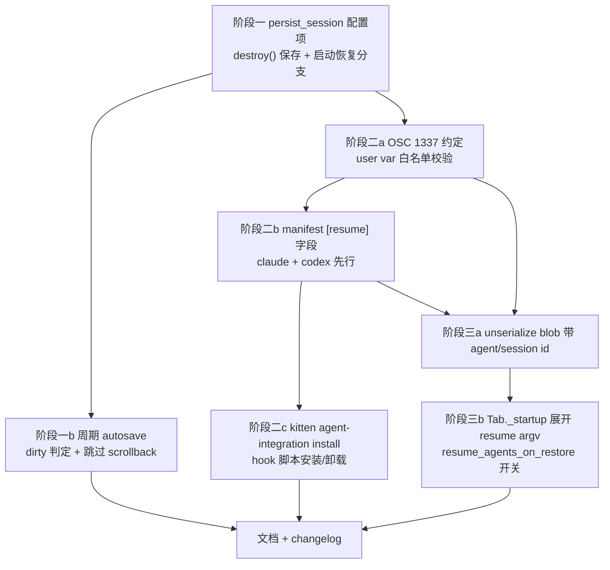

# kitty session + agent 自动持久化方案调研

目标：kitty 退出后下次启动自动恢复终端会话（OS 窗口 / 标签 / 布局 / 分屏 / cwd / 焦点 / 回滚缓冲）与 agent 会话（claude、codex 等的对话上下文），不采用 herdr 的 server+client 模式。

## 结论

**终端侧已经完全实现，不需要新造。** 本仓库（kitty fork）已有一套快照式（无守护进程）持久化：`kitty/logout_session.py` 整文件 + `save_as_session`。它保存 session 文件、每窗口 scrollback、实例 argv/cwd/environ，下次启动认领快照并重建，正是本需求的架构。

真正缺的只有三件事：

| 缺口 | 现状 | 工作量 |
|---|---|---|
| 1. 触发时机只有「系统注销」 | `is_logout_in_progress()` 门禁（`logout_session.py:432-434`），普通退出不存快照 | 小。加配置项 + 两个调用点 + 一个定时器 |
| 2. 无 agent 会话 id 捕获 | `AgentSnapshot` 只有 `window_id/agent/state/title/cwd`（`agents.py:33-39`）；OSC 7501 `Record` 无会话字段（`program_status.py:74-92`） | 中。需要新增传输通道 + manifest 字段 |
| 3. 无 resume 命令执行 | 恢复时一律起 shell；全仓库 grep `resume_argv|conversation_id|session_uuid` = 0 命中 | 中。需要白名单 + argv 校验 |

`docs/herdr-native-terminal-design.md:12,192-197` 已把 agent resume 写进设计稿（`resume_argv`、`source:"kitty-integration"`），但没有对应代码。

## 1. 已有能力清单（可直接复用，勿重写）

### 1.1 序列化：live 对象 → session 文件

```
Boss.serialize_state_as_session          boss.py:592-599   (按 focused/last-focused 排序 OS 窗口)
  TabManager.serialize_state_as_session  tabs.py:1865-1886 (new_os_window / class / name / 几何 / focus_tab)
    Tab.serialize_state_as_session       tabs.py:471-538   (new_tab / layout / enabled_layouts /
                                                            set_layout_state <json> / cd / launch… / focus)
      Window.as_launch_command           window.py:2541-2639
```

`Window.as_launch_command` 已覆盖：`--cwd` `--env` `--color` `--watcher` `--hold` `--var` padding/margin `--title` `--logo*` `--type=overlay|dock` `--allow-remote-control`，并把 `{id, cmd_at_shell_startup, font_size_override}` 塞进隐藏 JSON blob（`window.py:2605,2637`）。

布局保真由 `set_layout_state <json>` 承担（`tabs.py:540-552` → `layout/base.py:838-843`）。splits 的 `Pair` 树与 bias 递归序列化于 `layout/splits.py:42-66,1176-1225`；tall/grid/vertical 的 bias 字典见 `tall.py:378-385`、`grid.py:327-333`、`vertical.py:152-157`。**人写的 session 语法表达不了任意分屏树**，只有这个 JSON blob 能。

### 1.2 反序列化：session 文件 → live 窗口

```
main.py:325-337   _run_app: logout_snapshot_to_restore() or create_sessions()
main.py:291-303   logout_snapshot_to_restore: 父进程指定快照 or restore_session_after_logout 分支
boss.py:489-505   startup_first_child → add_os_window(session)
tabs.py:1574-1582 add_tabs_from_session
tabs.py:375-440   Tab._startup: 逐窗口 launch(restored_scrollback=…) → serialized_id →
                  font_size_override → resize_window → focus → unserialize_layout_state
```

`parse_session`（`session.py:230-313`）认得全部 19 个指令，包含 `set_layout_state` 与 launch 的 `kitty-unserialize-data=` blob（`session.py:133-155`）。

### 1.3 快照存储（无 daemon、崩溃安全）

`logout_session.py` 头部注释 `:4-23` 写明设计：每实例一个目录 `cache_dir()/<...>/<pid>`，内含 `session.kitty-session`、`scrollback/<serialized_id>`、`process.json`(argv/cwd/environ)。

| 机制 | 位置 |
|---|---|
| 原子写 | `save_snapshot` mkdtemp + `os.rename`（`:359-388`）；另有 `config.atomic_save` |
| 活实例保护 | `fcntl` flock：`lock_snapshot_for_saver` `:262-274`、`is_saver_running` `:284-296`。进程无论怎么死内核都会释放锁 |
| 多实例认领 | `claim_snapshots` `:457`，`restore_snapshots` `:551-568` 为非本机 argv 的快照另起 kitty 实例 |
| 失败计数 | `ATTEMPTS_FILE` + `MAX_RESTORE_ATTEMPTS=2`（`:50,59`），崩溃循环自动丢弃 |
| macOS 加密 | AES256GCM + Keychain，`KEYCHAIN_SERVICE` `:54`，`ENCRYPTED_FILE_MAGIC` `:55`。Keychain 禁止弹 UI，需交互则放弃保存 |
| 登录态环境变量隔离 | `LOGIN_SESSION_ENV_VARS` `:67-91`，恢复实例继承当前登录会话的 `DISPLAY`/`WAYLAND_DISPLAY`/`SSH_AUTH_SOCK` 等 |

### 1.4 scrollback 往返（已可用）

- 取：`scrollback_for_restore(screen)` `logout_session.py:319-342`，走 `as_text_for_history_buf`，拼接软换行以便按新宽度重排，剔除当前 prompt 与尾部空行。
- 消毒：`sanitize_restored_output` `:344-356`，只留 SGR / OSC8 / OSC66，去掉 OSC133 标记。
- 还：C 层 `Screen.restore_scrollback`（`screen.c:7127-7150`）；链路 `session.WindowSpec.restored_scrollback:57` → `launch.py:754,972,1021` → `tabs.py:398-401` → `window.py:808,1081-1088`，在子进程被标记 ready 之前注入，所以恢复内容一定在新输出之前。

注意：`save_as_session` 路径**不**存 scrollback，只有快照路径存。

### 1.5 agent 侧已有能力

- 检测：`detect_agent`（`agents.py:104-110`）按前台进程名查 `AGENT_EXECUTABLES`（`agents.py:56-84`，24 个条目，含 `env/node/bun/python` wrapper 剥离 `agents.py:94-101`）。
- 状态仲裁：`arbitrate`（`agents.py:123-156`）—— `state_authority = full_lifecycle` 的 agent 以 OSC 7501 语义上报为准，否则回退屏幕规则。manifest 引擎 `agent_manifest.py`（region/gate/rule，`:94-465`），23 份 TOML 位于 `kitty/agent_manifests/`。
- 跟踪：`AgentTracker`（`agents.py:189-274`）**纯内存**，无任何磁盘 I/O。
- 展示：macOS 原生侧栏 `boss.py:1925-2006`，`notify_agent_done` 完成通知。

## 2. 阶段一：把触发时机从「注销」放宽到「任意退出 + 周期自动保存」

这是纯粹的触发点工作，不碰序列化逻辑。

### 2.1 新增配置项

在 `kitty/options/definition.py` 紧挨 `restore_session_after_logout`（`:3275-3293`）新增：

```
persist_session  no|on-exit|always
```

- `no`：当前行为。
- `on-exit`：任意退出时写快照，下次启动无 `--session`/无命令行程序时恢复。
- `always`：外加周期性自动保存（见 2.3），应对 SIGKILL / OOM / 断电。

改动点：`definition.py` 加 `opt(...)`、`options/parse.py` 加 handler（照 `:1283-1284` 的 `restore_session_after_logout`）、`options/types.py` 两处（`:442`、`:669`）。注意 `types.py` 由 `gen/config.py` 生成，按仓库规则跑 `python3 gen/config.py`。

### 2.2 保存触发点

| 路径 | 位置 | 是否已有钩子 |
|---|---|---|
| 菜单/快捷键 quit（无需确认） | `boss.py:2750` | 有，`save_session_if_logging_out()` |
| quit 确认后 | `boss.py:2779` | 有，同上 |
| 最后一个窗口关闭 / SIGTERM / SIGHUP | `main.py:394-397` 的 `finally: boss.destroy()` | **唯一全覆盖钩子** |
| Linux 注销门户 | `boss.py:2813-2825` | 有 |
| SIGKILL / 崩溃 | 无钩子 | 只能靠 2.3 的周期保存 |

`child-monitor.c:136` 的 `KITTY_HANDLED_SIGNALS` 含 SIGINT/SIGTERM/SIGHUP，`handle_signal` `:1817-1825` 转成 `kill_signal` → 主循环返回 → Python `finally` 必执行。所以 **`Boss.destroy()` 是正确的落点**：在 `boss.py:3353` 的 `self.shutting_down = True` 之后、`self.child_monitor.shutdown_monitor()`（`:3360`）之前插入保存，此时 `os_window_map` 仍完整。

把 `save_session_if_logging_out`（`boss.py:2782-2787`）改为按配置分派：

```python
def save_session_if_needed(self, reason: str) -> None:
    mode = get_options().persist_session
    if mode == 'no':
        if is_logout_in_progress():   # 保留旧行为
            self.save_session_snapshot()
        return
    self.save_session_snapshot()
```

`save_session_at_logout`（`boss.py:2788-2799`）里的 `get_options().restore_session_after_logout` 门禁要改成「两个选项任一开启」，`is_panel_kitten()` 排除要保留。

幂等：`destroy()` 与 `quit()` 可能都触发。`save_snapshot` 里 `remove_snapshot(path) + os.rename`（`:380-381`）本身是覆盖语义，重复保存只是多一次 I/O；但保存耗时与 scrollback 量成正比，应加 `self.snapshot_saved_this_exit` 标志跳过第二次。

### 2.3 周期自动保存（`always`）

照抄 agent 侧栏定时器写法（`boss.py:2015` 的 `add_timer`，`boss.py:83` 已导入）：

```python
self.session_autosave_timer = add_timer(self.autosave_session, interval, True)
```

建议默认 60s，并加 dirty 判定避免无谓写盘：只有在窗口增删、tab 增删、layout 变更、cwd 变更时才置脏。可挂到现有 watcher 事件（`window.py:346-350`：`on_resize`/`on_title_change`/`on_cmd_startstop`）与 `Tab` 的布局变更点。

代价要算清楚：`scrollback_for_restore` 对每个窗口全量导出历史缓冲，2000 行 × N 窗口的字符串构造加 macOS 的 AES 加密，60s 一次在多窗口场景下不便宜。建议 `always` 模式下的周期保存**只写 session 文件、跳过 scrollback**，退出时的那次才写全量。

### 2.4 恢复触发点

`main.py:291-303` 的 `logout_snapshot_to_restore` 现在只在「父进程指定」或「`restore_session_after_logout` 且无 `--session`/无 args」时恢复。加一个分支：`persist_session != 'no'` 时走同样的 `restore_snapshots(opts, tuple(sys.argv[1:]))`。

现有保护全部继续生效：`ATTEMPTS_FILE` 失败计数、`is_saver_running` flock 判活（避免抢走仍在运行实例的快照）、`finish_restore` 恢复后删除（`main.py:378-380`）。

### 2.5 需要同步的文档

- `docs/sessions.rst:266-291`（`restore_after_logout` 小节）补充新模式。
- `docs/changelog.rst` 新条目（用户可见改动，仓库规则要求）。

## 3. 阶段二：agent 会话 id 捕获

### 3.1 问题本质

对话内容不在 kitty 手里。claude / codex 各自把 transcript 写在自己的目录（实测本机 `~/.codex/sessions/<Y>/<M>/<D>/*.jsonl`，首行 `{"type":"session_meta","payload":{"id":"019a90db-…","cwd":"…"}}`；claude 为 `~/.claude/projects/<escaped-cwd>/`）。kitty 能做的只有一件事：**记住 id，重启时用 agent 自己的 resume 参数重新拉起**。

所以要解决的是「kitty 怎么知道当前窗口里那个 agent 的会话 id」。三个候选通道：

| 方案 | 机制 | 可靠性 | 侵入性 |
|---|---|---|---|
| A. OSC 1337 SetUserVar | agent 的 hook 脚本把 `\x1b]1337;SetUserVar=KITTY_AGENT_SESSION=<base64>\x1b\\` 写到 `/dev/tty` | 高（精确对应窗口） | 需给每个 agent 装 hook |
| B. `kitten @ set-user-vars` | hook 走 `$KITTY_LISTEN_ON` socket | 高 | 需 hook + 需开 `allow_remote_control` |
| C. 扫 agent 自己的 session 目录 | 按 cwd + mtime 猜最近一次会话 | 低（同一 cwd 多窗口并发时必然串台） | 零 |

**推荐 A 为主、C 为兜底。** 理由：

- OSC 1337 是纯 tty 字节流，无需 socket、无需 `allow_remote_control`、不依赖 kitty 版本协商，hook 脚本只要 `printf > /dev/tty`。处理入口已存在：`window.py:1437-1442` `osc_1337()` → `set_user_var()`。
- **user var 已经在 session 序列化链路里**：`window.py:2570` 发 `--var=k=v`，`launch.py:227-230` 解析 `--var`，`launch.py:1004-1005` 在新窗口上 `set_user_var`。也就是说 **A 方案的 id 不写一行持久化代码就会自动进快照并在恢复后回到窗口上**。
- C 方案用于用户没装 hook 时降级，但必须标记为低置信度，且绝不能在同 cwd 有多个同种 agent 窗口时使用。

herdr 用的是 B 的等价物（`$HERDR_BIN_PATH pane report-agent --agent-session-id`，见 <https://herdr.dev/docs/add-herdr-support/>），因为它没有「user var 自动进 session 文件」这条现成管道。

#### A 方案已在本机实测验证

用本仓库已构建的 `kitty/launcher/kitty`（splits 布局 + 两个分屏）实测，全程未改一行代码：

1. 子 shell 里 `printf "\033]1337;SetUserVar=KITTY_AGENT_SESSION=%s\007" "$(printf %s 019a90db-… | base64)"`，随后 `kitten @ ls` 的 window 1 出现 `user_vars: {'KITTY_AGENT_SESSION': '019a90db-05e8-7c50-af14-8425b9d1c3a9'}`。
2. `kitten @ ls --output-format=session` 输出里该窗口的 launch 行自带该变量：

   ```
   layout splits
   set_layout_state {"pairs": {"one": 1, "two": 2}, …}
   cd /private/tmp
   launch 'kitty-unserialize-data={"id": 1}' --var=KITTY_AGENT_SESSION=019a90db-05e8-7c50-af14-8425b9d1c3a9
   focus
   launch 'kitty-unserialize-data={"id": 2}' --cwd=/private/etc
   focus_tab 0
   ```
3. 用该文件 `--session` 启动第二个 kitty 实例，`kitten @ ls` 得到 `layout: splits`、`pairs {'one': 1, 'two': 2}`、window 1 `cwd /private/tmp` 且 `user_vars` 原样回来。

结论：**布局（含 splits 树）、cwd、焦点、user var 的往返已经工作**。阶段二只需把 id 写进 user var，阶段三只需在恢复时按 id 组装命令。

实测中观察到一个值得注意的差异：window 2 以 `--cwd=/etc` 启动，但 `kitten @ ls` 的 JSON `cwd` 字段报的是 kitty 自身的工作目录 `/Users/anhoder/Desktop/kitty`，而 session 文件里写出的是正确的 `--cwd=/private/etc`。原因是两者取值路径不同：序列化走 `Window.cwd_for_serialization`（`window.py:2534-2539`，前台进程 cwd → 最老的前台进程 cwd → `child.cwd`，在 prompt 处再用 OSC 7 上报值覆盖），`Tab.serialize_state_as_session` 由此算出 `cd` 与 `--cwd`（`tabs.py:498`）；而 `as_dict` 的 `cwd` 走 `child.current_cwd or child.cwd`（`window.py:2484`），即 shell 进程此刻的真实 cwd。**任何基于 `ls` JSON 自建恢复逻辑的做法都会踩这个坑；应当始终复用 `serialize_state_as_session`。**


### 3.2 约定的 user var 名

```
KITTY_AGENT_ID        claude | codex | …   （与 manifest id 对齐）
KITTY_AGENT_SESSION   <会话 id>
```

`set_user_var` 有 64 个 key 上限并做控制字符消毒（`window.py:1421-1431`），够用且安全。

### 3.3 manifest 新增 resume 字段

`Manifest` NamedTuple（`agent_manifest.py:373-378`）现为 `id/version/authority/aliases/rules`，`parse_manifest` `:396-414`。新增：

```toml
[resume]
argv = ["claude", "--resume", "{session}"]
```

各 agent 的 resume 形态（herdr 文档 <https://herdr.dev/docs/session-state> 的整合表可作参照，落地前须逐个对本机实际 CLI 验证）：

| agent | resume 命令 |
|---|---|
| claude | `claude --resume <id>` |
| codex | `codex resume <id>` |
| opencode | `opencode --session <id>` |
| qwen / droid | `<bin> --resume <id>` |
| kimi / kilo | `<bin> --session <id>` |

只允许 `{session}` 一个占位符，argv 其余元素是 manifest 里的字面量 —— 这样恢复时执行的命令**完全由仓库内的 TOML 决定，不受子进程上报内容影响**，只有那个 id 是外部输入，且经过 3.5 的校验。

### 3.4 hook 脚本与安装

需要一个 `kitten agent-integration install <agent>` 子命令（参照 herdr 的 `herdr integration install`）：

- claude：往 `~/.claude/settings.json` 的 `hooks` 注册 `SessionStart`/`UserPromptSubmit`，脚本内容即 `printf '\033]1337;SetUserVar=%s\007' "$(printf 'KITTY_AGENT_SESSION=%s' "$(echo -n "$CLAUDE_SESSION_ID" | base64)")" > /dev/tty`（确切 hook 名与环境变量名需对照所装 claude 版本的文档核实）。
- codex / opencode / kilo 等各有自己的 plugin/hook 机制，逐个适配。
- 脚本必须：仅当 `KITTY_WINDOW_ID` 存在时动作、后台执行或带短超时、失败静默 —— 不能拖慢 agent。

这是本方案最大的工作量，也是唯一无法靠读 kitty 源码确定的部分：每个 agent 的 hook 协议要查各自文档/实测。建议先只做 claude + codex 两个，跑通后再扩。

### 3.5 id 校验（安全边界）

子进程可以任意写 OSC 1337，所以 id 必须当作不可信输入：

- 正则白名单：`[A-Za-z0-9_-]{1,64}`（UUID / 短 id 都满足）。不匹配则丢弃。
- 不做 shell 拼接。恢复时用 argv 数组直接 `launch`，不经 shell。
- `KITTY_AGENT_ID` 必须命中已加载 manifest 的 id/alias（`agent_manifest.py:506-507` `manifest_for`），否则丢弃。

### 3.6 AgentSnapshot 扩展

`AgentSnapshot`（`agents.py:33-39`）加两个字段 `session_id: str`、`resume_argv: tuple[str, ...]`，在 `snapshot_for_window`（`agents.py:172-186`）里从 `window.user_vars` 读取并按 manifest 组装。侧栏行（`AgentSidebarRow` `:42-50`）可顺带显示「可恢复」标记，但非必需。

注意：`AgentTracker` 仍可保持纯内存 —— 持久化靠 user var 走 session 文件，不需要 tracker 落盘。这比设计稿 `herdr-native-terminal-design.md:192-197` 的独立 `agent_resume` 快照块更省事。

## 4. 阶段三：恢复时执行 resume 命令

### 4.1 序列化侧

`Window.as_launch_command`（`window.py:2541-2639`）在 `--var` 之外，需要把 resume argv 变成被恢复窗口真正要跑的命令。两种写法：

1. **直接当命令写进 launch**：`launch --cwd=… --var=KITTY_AGENT_ID=claude --var=KITTY_AGENT_SESSION=<id> claude --resume <id>`。最简单，`session.py` 无需改动，`parse_session` 已经能解析。缺点：session 文件被别人编辑/搬运后会直接执行该命令，与 `--use-foreground-process` 的既有风险同级（`session.py` 的 save 选项已有大写 WARNING 说明该风险）。
2. **写进 `kitty-unserialize-data` JSON blob**：加 `agent_resume: {...}` 键（`window.py:2605`、`session.py:133-141` 两侧各加一个字段），恢复时由 kitty 查 manifest 重新组装 argv，而不是信任文件里的命令。更安全，推荐。

选 2 的话落点明确：

- 写：`window.py:2605-2637` 的 `unserialize_data` 里加 `{'agent': id, 'session': sid}`（**不存 argv，只存 id**）。
- 读：`session.py:133-141` 解析 blob 时存入 `WindowSpec.agent_resume`。
- 执：`tabs.py:384-403` `Tab._startup` 里，launch 之前按 manifest 把 `{session}` 展开成 argv 作为窗口命令。

这样 session 文件里只有 agent id + 会话 id，可执行命令永远来自仓库内 TOML。

### 4.2 默认关、显式开

新增 `resume_agents_on_restore no`（herdr 同名选项默认也可关）。理由：resume 会真的启动一个 agent 进程并消耗 token，用户未必希望开机即跑 5 个 claude。

关闭时的降级行为要明确：窗口按原 cwd 起 shell，scrollback 照常恢复，侧栏不显示 agent（因为进程没起）。

### 4.3 与 scrollback 恢复的关系

herdr 的规则是「resume 生效的 pane 不再回放屏幕历史」（`session-state` 文档）。kitty 这边建议相反：**两者都做**。因为 kitty 的 scrollback 注入发生在子进程 ready 之前（`window.py:1081-1088`），agent 的 TUI 全屏重绘会覆盖主屏，但历史仍在回滚缓冲里可以向上翻 —— 这是纯增益，没有冲突。

## 5. 风险与边界

| 风险 | 说明 | 应对 |
|---|---|---|
| 快照内含敏感数据 | scrollback + 全量 environ 落盘。Linux 不加密，只靠 0o700（`logout_session.py:369`） | 沿用现有策略并在文档明示；敏感窗口可考虑按 `--var` 标记跳过 |
| macOS 签名绑定 | 自编译 kitty 每次构建都算不同 app，Keychain 取不到 key，快照静默失效（`docs/sessions.rst` 已记载） | 本地开发期先用 Linux 验证，或接受 macOS 上降级为不加密需要显式配置 |
| 周期保存的 I/O 成本 | 全量 scrollback 导出 + 加密 | `always` 模式周期保存跳过 scrollback（见 2.3） |
| Wayland 无法恢复窗口位置 | `tabs.py:1892` / `boss.py:530` 显式跳过 | 文档说明，无解 |
| 同 cwd 多 agent 窗口 | 方案 C 兜底必然串台 | C 仅在该 cwd 只有一个该类 agent 窗口时启用，否则放弃 |
| 子进程伪造 agent 身份 | 任意程序可写 OSC 1337 | 3.5 的双重白名单 + argv 不经 shell |
| 恢复风暴 | 多实例快照各起一个 kitty（`restore_snapshots:551-568`） | 已有行为，`MAX_RESTORE_ATTEMPTS=2` 防崩溃循环 |

## 6. 实施顺序



阶段一独立可交付且用户立刻受益（普通退出也能恢复布局与 scrollback）。阶段二、三依赖各 agent 的 hook 协议调研，建议单独排期。

## 7. 验证方式

按仓库规则：`python3 .github/workflows/ci.py build` 或 `./dev.sh build`，产物在 `kitty/launcher/`；测试用 `./test.py <name>`，不要直接 `go test`。

- 阶段一：开 `persist_session on-exit`，开三个 OS 窗口、嵌套分屏、各自不同 cwd，跑点输出，`pkill -TERM kitty` 后重启，核对布局/cwd/焦点/scrollback。再用 `kill -9` 验证 `always` 模式的周期保存。
- 阶段二：窗口里跑 claude，`kitten @ ls | grep KITTY_AGENT_SESSION` 确认 id 到位；再 `kitten @ launch --var=KITTY_AGENT_SESSION='$(rm -rf /)'` 验证校验拦截。
- 阶段三：保存 → 退出 → 重启，确认 agent 窗口确实带 `--resume` 起来且对话历史在；关掉 `resume_agents_on_restore` 再验一次降级为 shell。
- 回归：`./test.py session`（若存在）与 logout 快照相关测试必须仍过 —— 阶段一改的是公共路径。
